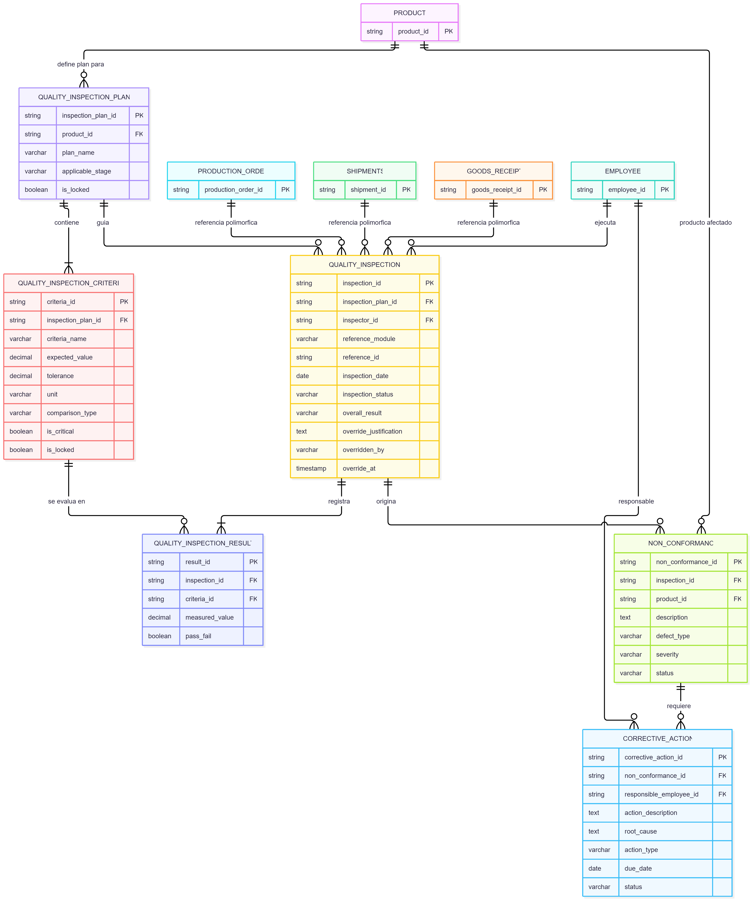

# Módulo ERP: Control de Calidad

MVP frontend de un módulo de **Control de Calidad** para un sistema ERP. Permite gestionar planes de inspección, evaluar lotes con un cálculo automático de tolerancias, registrar no conformidades y darles seguimiento con acciones correctivas (CAPA), con trazabilidad completa ante auditorías.

**Asignatura:** Modelación de Sistemas (580211), Universidad de Concepción · **Grupo:** 08 · **Metodología:** Spec-Driven Development con [Speckit](https://github.com/github/spec-kit)

---

## Contenido

1. [Cómo ejecutar](#1-cómo-ejecutar)
2. [Problema y solución](#2-problema-y-solución)
3. [Clientes y usuarios](#3-clientes-y-usuarios)
4. [Funcionalidades y navegación](#4-funcionalidades-y-navegación)
5. [Demo guiada (5 minutos)](#5-demo-guiada-5-minutos)
6. [Modelo de datos (MER)](#6-modelo-de-datos-mer)
7. [Manejo de datos sensibles y sesgos](#7-manejo-de-datos-sensibles-y-sesgos)
8. [Escalabilidad y desarrollo futuro](#8-escalabilidad-y-desarrollo-futuro)
9. [Documentación Speckit](#9-documentación-speckit)
10. [Decisiones de diseño](#10-decisiones-de-diseño)
11. [Arquitectura técnica](#11-arquitectura-técnica)
12. [Equipo](#12-equipo)
13. [Referencias](#13-referencias)

---

## 1. Cómo ejecutar

### Requisitos

- [Node.js](https://nodejs.org/) **20.19 o superior** (se recomienda 22 LTS). Para revisar tu versión: `node -v`.
- Git.
- Un navegador moderno (Chrome, Edge o Firefox).

### Pasos

```bash
# 1. Clonar el repositorio
git clone https://github.com/MDS-BI/Grupo-08.git
cd Grupo-08

# 2. Instalar dependencias (solo la primera vez)
npm install

# 3. Levantar la aplicación
npm run dev
```

Abre en el navegador la dirección que muestra la terminal, normalmente **http://localhost:5173**. Para detener la aplicación, presiona `Ctrl + C` en la terminal.

### Otros comandos

| Comando | Para qué sirve |
| :--- | :--- |
| `npm test` | Ejecuta las pruebas unitarias y de integración (Vitest) en modo observación. |
| `npx vitest run` | Ejecuta todas las pruebas una sola vez. |
| `npm run build` | Genera la versión de producción en `dist/`. |
| `npm run preview` | Sirve la versión de producción en http://localhost:4173. |

### Datos de prueba

Al iniciar, la aplicación carga automáticamente **datos semilla** desde `src/seed-data.js`: 3 productos (harina de trigo, aceite vegetal y azúcar refinada), 4 empleados, 3 recepciones, 2 órdenes de producción y 2 despachos. Estos datos representan los otros módulos del ERP, que Control de Calidad consulta pero no crea.

Los datos se guardan en el `localStorage` del navegador. Para **partir desde cero**, abre las herramientas de desarrollador (`F12`), ve a *Application → Local Storage*, borra los datos del sitio y recarga la página.

---

## 2. Problema y solución

**Problema.** En muchas empresas los controles de calidad se registran en planillas aisladas del flujo operativo. Esto permite que materias primas defectuosas entren a producción, que lotes con fallas sigan procesándose o que productos defectuosos lleguen al cliente. El resultado son devoluciones, mermas y pérdida de trazabilidad ante auditorías como ISO 9001.

**Solución.** Un módulo transversal del ERP que controla la calidad en las tres etapas de la cadena de valor:

| Etapa | Documento origen ("lote") | Ejemplo |
| :--- | :--- | :--- |
| `incoming` (recepción) | Recepción de compra (`goods_receipts`) | Sacos de harina que llegan del proveedor. |
| `in_process` (proceso) | Orden de producción (`production_orders`) | Lote fabricado en planta. |
| `final` (despacho) | Despacho (`shipments`) | Pedido antes de salir al cliente. |

El sistema compara cada medición con su tolerancia, calcula automáticamente el dictamen (*aprobado*, *condicional* o *reprobado*), genera la no conformidad cuando corresponde y obliga a darle seguimiento con una acción CAPA, con responsable y plazo.

---

## 3. Clientes y usuarios

**Cliente objetivo:** empresas manufactureras, industriales o distribuidoras de mediano y gran tamaño, con inventarios físicos y cadenas de suministro integradas, que necesitan estandarizar el control técnico de sus lotes y reducir los costos de no calidad.

| Rol | Necesidad | Qué hace en el módulo |
| :--- | :--- | :--- |
| **Inspector de Calidad** (operativo) | Saber qué lotes revisar y registrar mediciones sin errores. | Ve los lotes pendientes, ejecuta inspecciones, ingresa mediciones y adjunta evidencia. |
| **Jefe de Calidad / Planta** (táctico) | Definir estándares y resolver desviaciones. | Crea planes y criterios, revisa inspecciones condicionales, cambia dictámenes con justificación, gestiona no conformidades, cuarentena y CAPA, y configura alertas. |
| **Gerente de Operaciones** (estratégico) | Evaluar el desempeño y el cumplimiento normativo. | Consulta y exporta KPIs, revisa el historial y audita la trazabilidad y los plazos CAPA. |

En el MVP no hay inicio de sesión. El rol activo se elige con el selector **"Rol de uso"** del Dashboard.

---

## 4. Funcionalidades y navegación

La barra lateral tiene un grupo **"Control de Calidad"**, integrado dentro del template del módulo base del ERP (Panel, Entidades, Documentos, Búsqueda).

| Vista | Qué permite hacer |
| :--- | :--- |
| **Dashboard** | KPIs de tasa de aprobación (global y por etapa), no conformidades abiertas por severidad, CAPA vencidas, eficacia CAPA e inspecciones pendientes; Pareto de defectos por producto y por etapa; alertas configurables; exportación de KPIs a CSV; selector de rol. |
| **Lotes pendientes** | Documentos origen sin inspección completada, con el botón **Inspeccionar**. |
| **Planes** | Crear, editar, duplicar y eliminar planes por producto y etapa, y definir sus criterios: valor esperado, tolerancia, unidad, tipo de comparación (`range`, `min`, `max`, `boolean`) y si el criterio es crítico. Un plan con inspecciones queda bloqueado y se versiona duplicándolo. |
| **Inspecciones** | Formulario de inspección con evaluación automática por criterio, guardado como borrador, dictamen calculado al completar y evidencias adjuntas (PNG, JPG o PDF de hasta 5 MB). |
| **No conformidades** | Bandeja de revisión de inspecciones condicionales, cambio de dictamen con justificación, no conformidades (tipo, severidad, estado), acciones CAPA (responsable, causa raíz, tipo, fecha límite, estado), lotes en cuarentena y evidencias adjuntas de la no conformidad. |
| **Historial** | Trazabilidad desde la inspección hasta la no conformidad y la CAPA, con filtros por lote, módulo origen y rango de fechas, y exportación a CSV. |

### Reglas de negocio principales

- **Dictamen automático:** `failed` si falla al menos un criterio crítico, `conditional` si solo fallan criterios no críticos y `passed` si todos cumplen. Las tolerancias son inclusivas.
- **Inspección incompleta:** si falta alguna medición, la inspección queda en borrador (`draft`) y no recibe dictamen.
- **No conformidad automática:** una inspección reprobada genera un borrador de no conformidad con descripción, severidad `major` y estado `open`.
- **Cuarentena:** un lote aparece en cuarentena mientras tenga una no conformidad `open` o `under_review`. Cuando tiene una CAPA asignada, se muestra como "Cuarentena - En tratamiento".
- **CAPA vencida:** una acción no completada cuya fecha límite ya pasó se marca como vencida.

---

## 5. Demo guiada (5 minutos)

1. **Planes:** crea el plan "Recepción harina" para *Harina de trigo*, etapa *Recepción*. Agrega un criterio "Peso" con valor esperado 25, tolerancia 0,5, unidad kg, comparación `range` y marcado como **crítico**.
2. **Lotes pendientes:** pulsa **Inspeccionar** en `gr-001` (Harina de trigo).
3. **Inspecciones:** elige el plan y el inspector, ingresa **27** en el peso y pulsa **Completar inspección**. El dictamen es **Reprobado** y se genera la no conformidad.
4. **No conformidades:** asigna una CAPA con responsable, causa raíz ("balanza descalibrada"), acción "reproceso" y fecha límite. El lote pasa a "Cuarentena - En tratamiento".
5. Intenta **cambiar el dictamen a Aprobado:** el sistema lo bloquea porque falló un criterio crítico.
6. **Dashboard:** revisa los KPIs y el Pareto, y cambia el *Rol de uso* a *Gerente* para ver cómo se oculta el detalle por inspector.
7. **Historial:** filtra por el lote `gr-001` y exporta a CSV.

---

## 6. Modelo de datos (MER)



El módulo agrega **8 tablas** propias y se relaciona con **5 tablas** de otros módulos del ERP:

| Tabla | Descripción |
| :--- | :--- |
| `quality_inspection_plans` | Plan de inspección por producto y etapa (`incoming`, `in_process`, `final`). |
| `quality_inspection_criteria` | Parámetros del plan: valor esperado, tolerancia, unidad, tipo de comparación y criticidad. |
| `quality_inspections` | Inspección ejecutada, con su referencia polimórfica al lote (`reference_module` + `reference_id`), el inspector, el estado, el dictamen y la auditoría de cambios de dictamen. |
| `quality_inspection_results` | Medición por criterio y su cumplimiento (`pass_fail`), calculado por el sistema. |
| `non_conformances` | Desviaciones detectadas: tipo de defecto, severidad y estado. |
| `corrective_actions` | Acciones CAPA: responsable, causa raíz, tipo de acción, fecha límite y estado. |
| `quality_evidence` | Archivos de evidencia asociados a inspecciones o no conformidades. |
| `quality_alert_rules` | Reglas de alerta sobre los KPIs del dashboard. |
| *Externas:* `products`, `employees`, `goods_receipts`, `production_orders`, `shipments` | Datos de los otros módulos del ERP. Solo se consultan y validan. |

El diccionario de datos completo, con tipos, restricciones y reglas de integridad, está en [`specs/002-quality-control-module/data-model.md`](specs/002-quality-control-module/data-model.md).

---

## 7. Manejo de datos sensibles y sesgos

| Riesgo | Cómo lo mitiga el sistema |
| :--- | :--- |
| **Sesgo del inspector:** aprobar lotes que quedan justo en el límite. | El cumplimiento y el dictamen se calculan automáticamente y no se pueden editar a mano. Solo el Jefe de Calidad puede cambiar un dictamen, con justificación, usuario y fecha registrados, y **nunca** a *aprobado* si falló un criterio crítico. |
| **Privacidad y desempeño individual:** asociar fallas a personas puede generar un ambiente punitivo. | El dashboard muestra métricas agregadas por producto y etapa. El detalle por inspector solo lo ve el rol de Jefe de Calidad. |
| **Presión operativa:** despachar lotes defectuosos cuando hay urgencia. | Los lotes reprobados quedan visibles en cuarentena hasta que se gestione su no conformidad. |
| **Integridad histórica:** editar planes ya usados alteraría las inspecciones pasadas. | Los planes con historial se bloquean y se versionan duplicándolos. Una inspección con no conformidad no se puede eliminar. |

---

## 8. Escalabilidad y desarrollo futuro

La referencia polimórfica (`reference_module` + `reference_id`) permite sumar nuevos orígenes y funciones sin rehacer el modelo. Algunas posibilidades:

- **Bloqueo de inventario:** mover automáticamente a cuarentena el stock de lotes reprobados. Beneficia al Jefe de Planta.
- **Evaluación de proveedores:** cruzar las fallas en recepciones con las órdenes de compra para calificar proveedores. Beneficia a Compras y a la Gerencia.
- **Devoluciones (RMA):** agregar `rma` como nuevo origen de inspección.
- **Integración IoT:** capturar las mediciones directamente desde balanzas y sensores, lo que reduce el error humano del inspector.
- **Backend y autenticación:** reemplazar `localStorage` por una base de datos relacional con usuarios reales y permisos por rol.

El detalle está en [`plan.md` sección 15](specs/002-quality-control-module/plan.md).

---

## 9. Documentación Speckit

Toda la especificación vigente está en [`specs/002-quality-control-module/`](specs/002-quality-control-module/):

| Archivo | Contenido |
| :--- | :--- |
| [`spec.md`](specs/002-quality-control-module/spec.md) | Problema y solución, historias de usuario con criterios de aceptación, requisitos funcionales y criterios de éxito. |
| [`plan.md`](specs/002-quality-control-module/plan.md) | Plan técnico, usuarios, KPIs, riesgos, cronograma y escalabilidad. |
| [`data-model.md`](specs/002-quality-control-module/data-model.md) | Diccionario de datos, MER y reglas de integridad. |
| [`tasks.md`](specs/002-quality-control-module/tasks.md) | Tareas de desarrollo por historia de usuario. |
| [`research.md`](specs/002-quality-control-module/research.md) | Decisiones técnicas y alternativas evaluadas. |
| [`quickstart.md`](specs/002-quality-control-module/quickstart.md) | Guía de validación funcional. |
| [`contracts/`](specs/002-quality-control-module/contracts/) | Contratos del motor de inspección y del almacenamiento. |
| [`checklists/`](specs/002-quality-control-module/checklists/) | Checklists de calidad de la especificación. |

El módulo base del ERP, sobre el que se construye este módulo, está especificado en [`specs/001-erp-base-module/`](specs/001-erp-base-module/). La retroalimentación de cada avance está en [`feedback.md`](feedback.md).

---

## 10. Decisiones de diseño

Las decisiones principales están registradas como *issues* en la pestaña [Issues](https://github.com/MDS-BI/Grupo-08/issues?q=is%3Aissue) del repositorio:

1. El "lote" es el documento origen y no una tabla nueva.
2. Identificadores `string` y persistencia en `localStorage`.
3. El dictamen lo calcula el sistema y no se edita a mano.
4. Métricas agregadas; el detalle por inspector solo lo ve la Jefatura.
5. Los planes con historial se bloquean y se versionan.
6. Alcance del MVP y evolución futura.
7. El plan debe coincidir con el producto y la etapa del lote.
8. Reglas de cierre de no conformidades, cuarentena y CAPA.
9. Evidencias y alertas como extensión del MVP.

---

## 11. Arquitectura técnica

- **Stack:** [Vite](https://vite.dev/) + HTML, CSS y JavaScript sin frameworks, el mismo template del módulo base del ERP. Es una aplicación solo frontend.
- **Persistencia:** `localStorage`. Los datos de calidad usan las claves `erp_quality:*` y los del ERP base, `erp_base:*` y `erp_base_module:*`.
- **Motor de inspección:** función pura en `src/inspection-engine.js`, independiente de la interfaz y cubierta por pruebas unitarias.
- **Pruebas:** [Vitest](https://vitest.dev/) + jsdom, unitarias en `tests/unit/` e integración en `tests/integration/`.

```text
index.html                 Punto de entrada
src/
  app.js, main.js          Arranque y navegación
  module-config.js         Configuración del template (nombre, colores, etiquetas)
  storage.js               Colecciones en localStorage y reglas de integridad
  seed-data.js             Datos semilla de los módulos externos
  inspection-engine.js     Motor puro de evaluación de tolerancias
  components/              Vistas: dashboard, planes, lotes, inspección, NC/CAPA, historial, evidencias
tests/                     Pruebas unitarias y de integración
specs/                     Documentación Speckit (001 base, 002 calidad)
```

---

## 12. Equipo

- Plaza Palacios, Eduardo Andrés
- Ramírez Inostroza, Agustín Antonio
- Llanos Leal, Carla Antonia
- Valenzuela Carrasco, Raquel Esmeralda
- Athens Squella, Constanza Isidora
- Alvear Muñoz, Benjamín Andrés

--- | :--- |
| Plaza Palacios, Eduardo Andrés | `Eduard0771` |
| Ramírez Inostroza, Agustín Antonio | `aguR62104` |
| Llanos Leal, Carla Antonia | `carlaaall` |
| Valenzuela Carrasco, Raquel Esmeralda | `esme2005` |
| Athens Squella, Constanza Isidora | `cathenss` |
| Alvear Muñoz, Benjamín Andrés | `Benjamin` |

---

## 13. Referencias

- International Organization for Standardization. (2015). *ISO 9001:2015 Sistemas de gestión de la calidad: Requisitos*. ISO.
- International Organization for Standardization. (2015). *ISO 9000:2015 Sistemas de gestión de la calidad: Fundamentos y vocabulario*. ISO.
- Montgomery, D. C. (2019). *Introduction to Statistical Quality Control* (8.ª ed.). Wiley.
- GitHub. (2025). *Spec Kit: Toolkit for Spec-Driven Development*. https://github.com/github/spec-kit
- Vite. (2025). *Documentación de Vite*. https://vite.dev/
- Vitest. (2025). *Documentación de Vitest*. https://vitest.dev/
- Mermaid. (2025). *Entity Relationship Diagrams*. https://mermaid.js.org/syntax/entityRelationshipDiagram.html
- Material del curso Modelación de Sistemas 2026-2, Universidad de Concepción.
