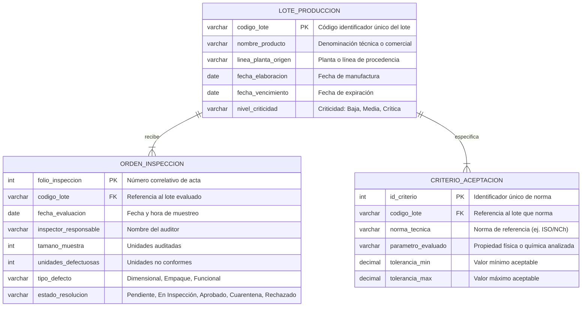

# Módulo ERP: Control de Calidad

Módulo de software ERP orientado a **Control de Gestión**, enfocado en la trazabilidad, inspección y aseguramiento de estándares de calidad sobre lotes de producción y recepción de suministros.

---

## 1. Información del Equipo

* **Asignatura:** Modelación de Sistemas (580211)
* **Módulo:** Control de Calidad
* **Equipo de Trabajo:**
  * Plaza Palacios Eduardo Andres
  * Ramírez Inostroza Agustín Antonio
  * Llanos Leal Carla Antonia
  * Valenzuela Carrasco Raquel Esmeralda
  * Athens Squella Constanza Isidora
  * Alvear Muñoz Benjamín Andrés

---

## 2. Visión del Producto

### Propósito del Módulo
Asegurar que cada lote elaborado o materia prima recibida cumpla con los estándares de aceptación técnica y especificaciones de calidad antes de su liberación a inventario o despacho comercial, previniendo mermas, reprocesos y reclamos de clientes.

### Clientes y Usuarios Clave
* **Inspectores / Analistas de Calidad:** Personal operativo responsable de registrar muestreos, ingresar mediciones técnicas y reportar defectos o no conformidades.
* **Jefatura de Calidad:** Rol supervisor que evalúa el historial, aprueba liberaciones y gestiona lotes retenidos o rechazados.
* **Supervisores de Operaciones / Planta:** Usuarios que monitorean el estado de los lotes para coordinar reprocesos, almacenamiento en cuarentena o autorización de entrega.

---

## 3. Descripción Conceptual del Dominio (Caso de Negocio)

Una planta productiva requiere implementar un módulo ERP para gestionar el aseguramiento y control de calidad de sus operaciones. Para cada **Lote de Producción (Entidad)**, el sistema mantiene un código identificador único, el nombre o descripción del ítem, la línea o planta de procedencia, fecha de elaboración, fecha de caducidad y un nivel de criticidad asignado; asimismo, cada lote tiene asociados diversos criterios técnicos y tolerancias normativas que debe satisfacer para su liberación comercial.

Cualquier analista acreditado puede ejecutar controles formales mediante el registro de una **Orden de Inspección (Documento)**, la cual se caracteriza por su número de folio correlativo, fecha de evaluación, tamaño muestral analizado, cantidad de no conformidades detectadas, tipología de defecto (dimensional, funcional o empaque) y observaciones técnicas. Toda orden de inspección pertenece obligatoriamente a un único lote específico y dictamina el estado del control (Pendiente, En Inspección, Aprobado, En Cuarentena o Rechazado), manteniéndose una relación histórica donde un lote puede acumular múltiples inspecciones que se descartan en cascada si el lote maestro es eliminado.

---

## 4. Mapeo Conceptual al Módulo Base ERP

Correspondencia entre la arquitectura base de la aplicación y el dominio de Calidad:

| Elemento Base ERP | Instanciación en Calidad | Atributos Principales |
| :--- | :--- | :--- |
| **Entidad (Master Data)** | **Lote de Producción** | Código de lote, nombre producto, línea/planta de origen, fecha elaboración, fecha vencimiento, criticidad. |
| **Documento (Transaccional)** | **Orden de Inspección** | Serie y folio, fecha inspección, tamaño muestra, defectos detectados, tipo de falla, estado final. |

### Ciclo de Estados de Inspección:
* `Pendiente`: Lote ingresado en espera de toma de muestras.
* `En Inspección`: Pruebas de laboratorio o metrología en curso.
* `Aprobado`: Cumplimiento del 100% de tolerancias. Lote liberado.
* `En Cuarentena`: No conformidades menores detectadas; lote bajo observación o re-muestreo.
* `Rechazado`: No cumple parámetros críticos. Lote bloqueado para descarte o reproceso.

---

## 5. Modelo Entidad-Relación Conceptual (MER)


---
       
# ERP Software Base Module (Vite + Vanilla JS)

Minimal single-page app serving as an Enterprise Resource Planning (ERP) software base module. It provides the common foundation for building custom ERP modules: master data management (Entities) and linked transactional documents (Documents) with create/edit/delete/search, validation, and browser localStorage persistence — using Vite and vanilla HTML, CSS, and JavaScript.

The user interface is fully in **Spanish** (default terms: Entidad / Documento; module name: Módulo Base ERP), including labels, validation messages, empty states, and dialogs.

Entities carry standard ERP master-data fields (name, code, tax ID, email, phone, address, category, target date, credit limit, payment terms). Documents use series + folio numbering and carry a monetary breakdown (subtotal, discount, tax, total), currency, payment terms, notes, quantity, dates, and status.

The app presents itself as a coherent ERP workspace:

- **Workspace shell** — every screen lives inside a branded chrome: a top bar with a logo (an SVG monogram derived from the module name) and module name, plus a persistent sidebar of module buttons (Panel, Entidades, Documentos, Búsqueda). The active module is highlighted (`aria-current="page"`), and the sidebar collapses to an icon rail on narrow viewports.
- **Home dashboard** — the entry screen offers quick-action buttons for key ERP tasks (new entity, new document, open management areas, find records) and live statistic cards showing record counts.
- **Design tokens** — styling is driven by CSS custom properties in `src/styles.css`, so branding changes apply globally.

## Setup

Install dependencies and run the dev server:

```bash
npm install
npm run dev
```

Open http://localhost:5173 (or the URL Vite prints).

## Tests

Run the full test suite (unit + integration) with:

```bash
npm test
```

Or a one-off run without watch mode:

```bash
npx vitest run
```

## Building Custom Modules

Custom ERP modules built on this base define:

- What an **Entity** represents (e.g., customer, product, asset) plus domain-specific fields.
- What a **Document** represents (e.g., order, invoice, contract).
- Module-specific labels and validation rules.

The base module handles identity generation, timestamps, referential integrity between entities and documents, cascade deletion, navigation, and search. See `specs/001-erp-base-module/` for the full specification.

## Tailoring via Configuration

All tailoring lives in one place: the `userConfig` object at the top of `src/module-config.js`. Developers edit this single export; no core code changes are required. Available knobs:

- `moduleName` — display name shown in the top bar, dashboard, and document title; also derives the logo monogram.
- `labels` — rename Entity/Document terms across every screen, including sidebar buttons, quick actions, forms, and messages. Spanish articles and agreements (el/la, seleccionado/a) are derived from the first word of each configured term.
- `customFields` — declare extra fields per record type with `target` (`entity` or `document`), `key`, `label`, `type` (`text`, `number`, `date`, or `select`), optional `required`, and `options` for selects. Keys must not collide with base field names (see `specs/001-erp-base-module/data-model.md`). Values persist alongside records and appear in search results.
- `statusLifecycle` — restrict document statuses to a configured list of `statuses` with permitted `transitions` between them. Without it, status stays a free-form field.
- `theme.accentColor` — a hex color (e.g., `"#0f62fe"`) applied across the shell as highlights and primary controls. Invalid values fall back to the default.

If the configuration is invalid (unknown types, bad keys, transitions referencing unknown statuses, non-hex accent colors), the app shows the problems in a banner and falls back to defaults instead of breaking.

## Notes

- Data is persisted to `localStorage` under the keys `erp_base_module:entities` and `erp_base_module:documents`.
- Deleting an entity also deletes its documents (cascade).
- This project intentionally uses vanilla HTML, CSS, and JavaScript for simplicity.
