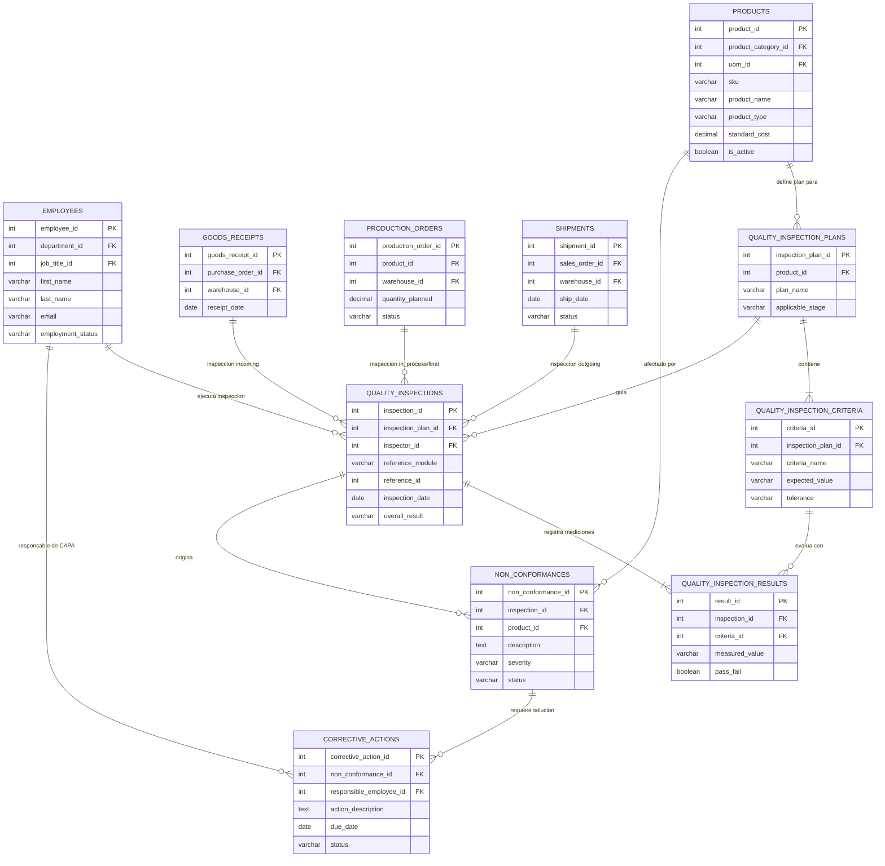

# Especificación del Modelo de Datos: Control de Calidad (Quality Control)

**Módulo:** Control de Calidad  
**Documento Base:** `erp_data_model.md`  
**Proyecto:** ERP Frontend MVP — Modelación de Sistemas (UdeC)  

**Integrantes del Grupo:**
* Plaza Palacios Eduardo Andres
* Ramírez Inostroza Agustín Antonio
* Llanos Leal Carla Antonia
* Valenzuela Carrasco Raquel Esmeralda
* Athens Squella Constanza Isidora
* Alvear Muñoz Benjamín Andrés

---

## 1. Visión General de la Estructura de Datos

El módulo de **Control de Calidad** estructura la captura de datos tanto preventivos (Planes y Criterios de Inspección) como operativos (Ejecución de Inspecciones, Resultados, No Conformidades y Acciones Correctivas CAPA). 

Es 100% compatible y se conecta fluidamente con el modelo relacional base del ERP (`erp_data_model.md`) mediante claves primarias sustitutas (`INT`) y claves foráneas cruzadas hacia **Logística e Inventario** (`products`, `goods_receipts`, `shipments`), **Recursos Humanos** (`employees`) y **Operaciones/Manufactura** (`production_orders`).

---

## 2. Diagrama Entidad-Relación (MER)

A continuación se presenta el esquema visual del modelo entidad-relación en sintaxis **Mermaid**, listo para visualizarse automáticamente en GitHub con sus atributos y relaciones:

---

## 3. Diccionario de Datos del Módulo de Calidad

### 3.1 `quality_inspection_plans`
Define las pautas de control predeterminadas para un producto en particular.

| Columna | Tipo | Clave | Referencia / Restricción | Descripción |
| :--- | :--- | :--- | :--- | :--- |
| `inspection_plan_id` | INT | PK | Autoincremental | Identificador único del plan de inspección. |
| `product_id` | INT | FK | `products.product_id` *(Logística)* | Producto al cual se aplica la pauta de control. |
| `plan_name` | VARCHAR | - | Not Null | Nombre descriptivo del plan de control. |
| `applicable_stage` | VARCHAR | - | `incoming`, `in_process`, `final` | Etapa operativa donde se debe aplicar la inspección. |

### 3.2 `quality_inspection_criteria`
Detalla los parámetros específicos a medir en cada plan de inspección.

| Columna | Tipo | Clave | Referencia / Restricción | Descripción |
| :--- | :--- | :--- | :--- | :--- |
| `criteria_id` | INT | PK | Autoincremental | Identificador único del criterio de medición. |
| `inspection_plan_id` | INT | FK | `quality_inspection_plans.inspection_plan_id` | Plan de inspección al que pertenece el criterio. |
| `criteria_name` | VARCHAR | - | Not Null | Variable o parámetro a evaluar (ej: Peso, PH, Dimensión). |
| `expected_value` | VARCHAR | - | Not Null | Valor o rango estándar de referencia. |
| `tolerance` | VARCHAR | - | Nullable | Margen de tolerancia permitido (ej: ±0.05 mm, Max 5%). |

### 3.3 `quality_inspections`
Registro de un evento real de inspección ejecutado en terreno.

| Columna | Tipo | Clave | Referencia / Restricción | Descripción |
| :--- | :--- | :--- | :--- | :--- |
| `inspection_id` | INT | PK | Autoincremental | Identificador único del evento de inspección. |
| `inspection_plan_id` | INT | FK | `quality_inspection_plans.inspection_plan_id` | Plan utilizado para realizar la evaluación. |
| `inspector_id` | INT | FK | `employees.employee_id` *(RRHH)* | Empleado técnico que ejecuta la inspección. |
| `reference_module` | VARCHAR | *Polimórfico* | `goods_receipt`, `production_order`, `shipment` | Módulo de origen de la orden/documento. |
| `reference_id` | INT | *Polimórfico* | ID del documento origen | Clave primaria del documento inspeccionado. |
| `inspection_date` | DATE | - | Not Null | Fecha de realización de la inspección. |
| `overall_result` | VARCHAR | - | `passed`, `failed`, `conditional` | Dictamen global del lote o producto inspeccionado. |

### 3.4 `quality_inspection_results`
Mediciones cuantitativas/cualitativas tomadas para cada criterio durante la inspección.

| Columna | Tipo | Clave | Referencia / Restricción | Descripción |
| :--- | :--- | :--- | :--- | :--- |
| `result_id` | INT | PK | Autoincremental | Identificador del resultado específico. |
| `inspection_id` | INT | FK | `quality_inspections.inspection_id` | Evento de inspección padre. |
| `criteria_id` | INT | FK | `quality_inspection_criteria.criteria_id` | Criterio evaluado. |
| `measured_value` | VARCHAR | - | Not Null | Valor real obtenido en la medición. |
| `pass_fail` | BOOLEAN | - | True (Pasa) / False (Falla) | Cumplimiento del criterio individual. |

### 3.5 `non_conformances`
Registro formal de desviaciones o defectos detectados en productos.

| Columna | Tipo | Clave | Referencia / Restricción | Descripción |
| :--- | :--- | :--- | :--- | :--- |
| `non_conformance_id`| INT | PK | Autoincremental | Identificador único de la No Conformidad. |
| `inspection_id` | INT | FK | `quality_inspections.inspection_id` | Inspección origen donde se detectó la falla. |
| `product_id` | INT | FK | `products.product_id` *(Logística)* | Producto afectado por el defecto. |
| `description` | TEXT | - | Not Null | Detalle descriptivo de la anomalía hallada. |
| `severity` | VARCHAR | - | `minor`, `major`, `critical` | Nivel de impacto del defecto en la operación. |
| `status` | VARCHAR | - | `open`, `under_review`, `closed` | Estado de resolución de la no conformidad. |

### 3.6 `corrective_actions`
Acciones correctivas o preventivas (CAPA) diseñadas para subsanar no conformidades.

| Columna | Tipo | Clave | Referencia / Restricción | Descripción |
| :--- | :--- | :--- | :--- | :--- |
| `corrective_action_id`| INT | PK | Autoincremental | Identificador de la acción correctiva. |
| `non_conformance_id`| INT | FK | `non_conformances.non_conformance_id` | No conformidad que origina la acción. |
| `responsible_employee_id`| INT | FK | `employees.employee_id` *(RRHH)* | Empleado encargado de ejecutar la solución. |
| `action_description`| TEXT | - | Not Null | Descripción de la medida correctiva a aplicar. |
| `due_date` | DATE | - | Not Null | Fecha límite fijada para la implementación. |
| `status` | VARCHAR | - | `pending`, `in_progress`, `completed` | Estado de ejecución de la acción correctiva. |

---

## 4. Mapeo de Relaciones Cruzadas (Cross-Module Map)

| # en ERP | Origen (`Módulo.Tabla.Columna`) | Destino (`Módulo.Tabla.Columna`) | Propósito e Integración |
| :--- | :--- | :--- | :--- |
| **51** | `Quality.quality_inspection_plans.product_id` | `Logistics.products.product_id` | Asocia pautas de control a productos del catálogo maestro. |
| **52** | `Quality.quality_inspections.inspector_id` | `HR.employees.employee_id` | Asigna responsabilidad del registro al inspector. |
| **53** | `Quality.quality_inspections.reference_id` | *Polimórfico* (`goods_receipts` / `production_orders` / `shipments`) | Permite trazabilidad end-to-end de calidad en compras, manufactura y despacho. |
| **54** | `Quality.non_conformances.product_id` | `Logistics.products.product_id` | Identifica el ítem afectado para manejo de cuarentena/inventario. |
| **55** | `Quality.corrective_actions.responsible_employee_id` | `HR.employees.employee_id` | Asigna la resolución de fallas al personal responsable. |

---

## 5. Notas sobre Patrones de Diseño y Compatibilidad

1. **Patrón Polimórfico en Inspecciones**: La tabla `quality_inspections` utiliza el discriminador `reference_module` junto con `reference_id`, tal como lo define `erp_data_model.md`. Esto evita crear múltiples columnas foráneas nulas y permite conectar el módulo con Recepciones, Producción y Despachos sin alterar las tablas de otros equipos.
2. **Trazabilidad CAPA (Corrective and Preventive Action)**: Garantiza el ciclo de mejora continua ISO 9001, conectando la medición fallida con su no conformidad y el plan de resolución con fecha de vencimiento.
