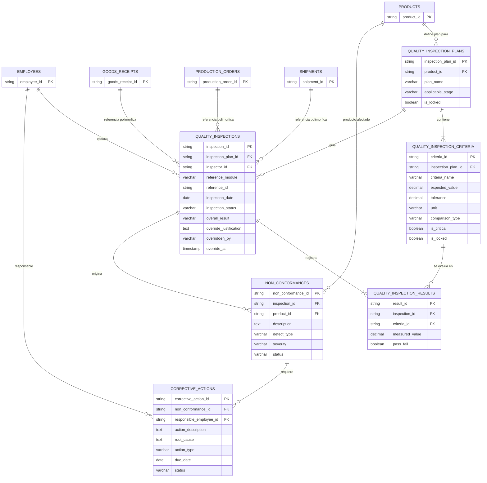

# Modelo de Datos: Módulo de Control de Calidad

**Módulo:** Control de Calidad  
**Proyecto:** ERP Frontend MVP — Modelación de Sistemas (UdeC)  
**Modelo relacionado:** [Módulo Base ERP](../001-erp-base-module/data-model.md)

## 1. Propósito y alcance

Este documento define las estructuras de datos para gestionar el control de calidad preventivo y operativo: planes y criterios de inspección, inspecciones, resultados, no conformidades y acciones correctivas o preventivas (CAPA).

El módulo se integra con productos, empleados, recepciones, órdenes de producción y despachos. Estas entidades son dependencias de otros módulos ERP; no se consideran creadas por este modelo de Control de Calidad. El "lote" de las historias de usuario se representa mediante el documento origen (`reference_module` + `reference_id`); no existe una entidad de lote separada.

## 2. Diagrama entidad-relación

Las relaciones desde recepciones, órdenes de producción y despachos representan referencias polimórficas: `reference_module` identifica el módulo de origen y `reference_id` identifica su registro. No son claves foráneas convencionales y requieren validación de la aplicación o una estrategia de integración equivalente.

> **Nota de implementación.** El diagrama usa identificadores `string` para reflejar el MVP frontend con `localStorage`, coherente con el módulo base. Si se implementa el diseño relacional lógico con claves `INT`, debe existir una capa de mapeo explícita `INT ↔ string` documentada en [contracts/quality-storage.md](contracts/quality-storage.md). Las reglas de negocio y cardinalidades no cambian.

## 3. Diccionario de datos

### 3.1 `quality_inspection_plans`

Define las pautas de control aplicables a un producto.

| Columna | Tipo | Clave | Referencia / Restricción | Descripción |
|---|---|---|---|---|
| `inspection_plan_id` | STRING | PK | Autogenerado | Identificador único del plan. |
| `product_id` | STRING | FK | `products.product_id` | Producto al que se aplica el plan. |
| `plan_name` | VARCHAR | — | Not Null | Nombre descriptivo del plan. |
| `applicable_stage` | VARCHAR | — | `incoming`, `in_process`, `final` | Etapa en que se aplica la inspección. |
| `is_locked` | BOOLEAN | — | Default `false` | Indica que el plan tiene inspecciones históricas y no puede editarse ni eliminarse. |

### 3.2 `quality_inspection_criteria`

Detalla los parámetros que deben evaluarse para un plan.

| Columna | Tipo | Clave | Referencia / Restricción | Descripción |
|---|---|---|---|---|
| `criteria_id` | STRING | PK | Autogenerado | Identificador único del criterio. |
| `inspection_plan_id` | STRING | FK | `quality_inspection_plans.inspection_plan_id` | Plan al que pertenece el criterio. |
| `criteria_name` | VARCHAR | — | Not Null | Variable o parámetro que se evalúa (por ejemplo, peso, pH o dimensión). |
| `expected_value` | DECIMAL | — | Not Null | Valor o límite estándar de referencia. |
| `tolerance` | DECIMAL | — | Not Null, >= 0 | Margen de tolerancia permitido para `range`. |
| `unit` | VARCHAR | — | Not Null | Unidad de medida (kg, °C, mm, etc.). |
| `comparison_type` | VARCHAR | — | `range`, `min`, `max`, `boolean` | Regla de comparación aplicada al medir. |
| `is_critical` | BOOLEAN | — | Not Null | Indica si el incumplimiento genera `failed`. |
| `is_locked` | BOOLEAN | — | Default `false` | Indica que el criterio tiene resultados históricos y no puede editarse ni eliminarse. |

### 3.3 `quality_inspections`

Registra un evento de inspección.

| Columna | Tipo | Clave | Referencia / Restricción | Descripción |
|---|---|---|---|---|
| `inspection_id` | STRING | PK | Autogenerado | Identificador único de la inspección. |
| `inspection_plan_id` | STRING | FK | `quality_inspection_plans.inspection_plan_id` | Plan utilizado. |
| `inspector_id` | STRING | FK | `employees.employee_id` | Empleado que ejecuta la inspección. |
| `reference_module` | VARCHAR | Polimórfica | `goods_receipt`, `production_order`, `shipment` | Módulo del registro inspeccionado. |
| `reference_id` | STRING | Polimórfica | ID del registro origen | Identificador del lote/documento inspeccionado. |
| `inspection_date` | DATE | — | Not Null | Fecha de realización. |
| `inspection_status` | VARCHAR | — | `draft`, `completed` | Estado del registro de inspección. |
| `overall_result` | VARCHAR | — | `passed`, `failed`, `conditional`; Null mientras `draft` | Dictamen global derivado. |
| `override_justification` | TEXT | — | Obligatorio si cambia el dictamen | Motivo registrado del cambio manual. |
| `overridden_by` | VARCHAR | — | Obligatorio si cambia el dictamen | Usuario o rol que autoriza el cambio. |
| `override_at` | TIMESTAMP | — | Obligatorio si cambia el dictamen | Fecha y hora del cambio de dictamen. |

### 3.4 `quality_inspection_results`

Almacena las mediciones de cada criterio evaluado durante una inspección.

| Columna | Tipo | Clave | Referencia / Restricción | Descripción |
|---|---|---|---|---|
| `result_id` | STRING | PK | Autogenerado | Identificador único del resultado. |
| `inspection_id` | STRING | FK | `quality_inspections.inspection_id` | Inspección a la que pertenece. |
| `criteria_id` | STRING | FK | `quality_inspection_criteria.criteria_id` | Criterio evaluado. |
| `measured_value` | DECIMAL | — | Not Null | Valor numérico obtenido en la medición. |
| `pass_fail` | BOOLEAN | — | Not Null, calculado | Indica si el criterio se cumple. |

### 3.5 `non_conformances`

Registra desviaciones o defectos detectados.

| Columna | Tipo | Clave | Referencia / Restricción | Descripción |
|---|---|---|---|---|
| `non_conformance_id` | STRING | PK | Autogenerado | Identificador único de la no conformidad. |
| `inspection_id` | STRING | FK | `quality_inspections.inspection_id` | Inspección en la que se detectó. |
| `product_id` | STRING | FK | `products.product_id` | Producto afectado, tomado del plan. |
| `description` | TEXT | — | Not Null, no vacío | Descripción de la anomalía; autogenerada y editable. |
| `defect_type` | VARCHAR | — | `dimensional`, `functional`, `packaging`, `other` | Tipo de defecto; por defecto `other` al autogenerarse. |
| `severity` | VARCHAR | — | `minor`, `major`, `critical` | Nivel de impacto; por defecto `major` al autogenerarse. |
| `status` | VARCHAR | — | `open`, `under_review`, `closed` | Estado de resolución; por defecto `open`. |

### 3.6 `corrective_actions`

Define las acciones correctivas o preventivas (CAPA) asociadas a no conformidades.

| Columna | Tipo | Clave | Referencia / Restricción | Descripción |
|---|---|---|---|---|
| `corrective_action_id` | STRING | PK | Autogenerado | Identificador único de la acción. |
| `non_conformance_id` | STRING | FK | `non_conformances.non_conformance_id` | No conformidad que origina la acción. |
| `responsible_employee_id` | STRING | FK | `employees.employee_id` | Empleado responsable. |
| `action_description` | TEXT | — | Not Null | Medida que se debe aplicar. |
| `root_cause` | TEXT | — | Not Null | Causa raíz identificada. |
| `action_type` | VARCHAR | — | `resampling`, `rework`, `other` | Tipo de acción a ejecutar. |
| `due_date` | DATE | — | Not Null | Fecha límite de implementación. |
| `status` | VARCHAR | — | `pending`, `in_progress`, `completed` | Estado de la acción. |

## 4. Integración con otros módulos

| Dato de Control de Calidad | Módulo de destino | Propósito |
|---|---|---|
| `quality_inspection_plans.product_id` | Logística: `products.product_id` | Asociar planes de inspección al catálogo de productos. |
| `quality_inspections.inspector_id` | Recursos Humanos: `employees.employee_id` | Identificar al inspector responsable. |
| `quality_inspections.reference_module` + `reference_id` | Compras, Manufactura o Despachos | Mantener trazabilidad con recepciones, órdenes de producción y despachos. |
| `non_conformances.product_id` | Logística: `products.product_id` | Identificar el producto afectado. |
| `corrective_actions.responsible_employee_id` | Recursos Humanos: `employees.employee_id` | Asignar la ejecución de la acción CAPA. |

### Consideraciones de integración

- El [modelo de datos del módulo base](../001-erp-base-module/data-model.md) define `Entity` y `Document`, pero no define las tablas `products`, `employees`, `goods_receipts`, `production_orders` ni `shipments`. Esas referencias dependen de los módulos correspondientes y no deben considerarse implementadas por este documento.
- El MVP usa identificadores `string` y `localStorage`. El modelo relacional con `INT` se conserva como diseño lógico; cualquier implementación relacional requiere una capa de mapeo explícita.
- El campo polimórfico `reference_id` no puede garantizar por sí solo la existencia del registro de origen mediante una clave foránea relacional. La integración debe validar el par `reference_module` y `reference_id`.
- La implementación de este modelo requiere integrar las dependencias externas; documentar las relaciones no agrega esas entidades ni cambia el código de la aplicación.

## 5. Reglas de negocio e integridad

- **Habilitación de planes:** un plan sin al menos un criterio no se habilita para iniciar inspecciones.
- **Evaluación:** `pass_fail` se calcula según `comparison_type`:
  - `range`: `expected_value - tolerance <= measured_value <= expected_value + tolerance`.
  - `min`: `measured_value >= expected_value`.
  - `max`: `measured_value <= expected_value`.
  - `boolean`: `measured_value` coincide con `expected_value` (1 = cumple, 0 = no cumple).
- **Inspección incompleta:** si falta la medición de cualquier criterio o el valor no es numérico, la inspección permanece `draft` y no tiene `overall_result`.
- **Dictamen:** con la inspección completa, `failed` si falla al menos un criterio crítico, `conditional` si solo hay desviaciones no críticas y `passed` si todos cumplen.
- **Cambio manual:** el Jefe de Calidad puede cambiar `overall_result` solo con `override_justification`, `overridden_by` y `override_at`; nunca puede establecer `passed` si existe un criterio crítico fallido o sin medición.
- **Revisión condicional:** `conditional` se muestra en la bandeja de revisión y no genera no conformidad automática.
- **No conformidad automática:** una inspección `failed` genera un borrador `open` con tipo de defecto `other`, severidad `major`, producto del plan y descripción autogenerada de los criterios incumplidos.
- **CAPA vencida:** una acción con `due_date` anterior a la fecha actual y `status != completed` se marca como vencida sin cambiar su estado.
- **Bloqueo histórico:** un plan o criterio con resultados de inspección asociados tiene `is_locked = true` y no puede editarse ni eliminarse; el plan se duplica para crear una nueva versión.
- **Eliminación:** plan sin inspecciones elimina sus criterios en cascada; inspección sin no conformidad elimina sus resultados en cascada; inspección con no conformidad no se elimina; no conformidad elimina sus CAPA en cascada.
- **Lotes pendientes:** se derivan de los documentos origen externos que no tienen una inspección `completed`; una inspección `draft` no marca el lote como inspeccionado.
- **Cuarentena:** un lote con al menos una no conformidad en estado `open` o `under_review` se muestra como retenido/en cuarentena; si tiene una CAPA asociada se muestra "Cuarentena - En tratamiento".

## 6. Trazabilidad de no conformidades y CAPA

Los resultados de inspección permiten identificar criterios incumplidos. Una inspección puede originar no conformidades, y cada no conformidad puede tener acciones correctivas o preventivas con responsable, causa raíz, tipo de acción, fecha límite y estado. Este encadenamiento conserva la trazabilidad desde la medición hasta la resolución.
