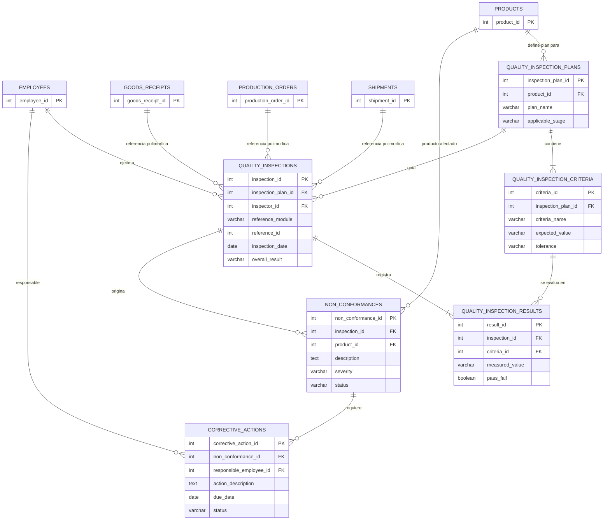

# Modelo de Datos: Módulo de Control de Calidad

**Módulo:** Control de Calidad  
**Proyecto:** ERP Frontend MVP — Modelación de Sistemas (UdeC)  
**Modelo relacionado:** [Módulo Base ERP](../001-erp-base-module/data-model.md)

## 1. Propósito y alcance

Este documento define las estructuras de datos para gestionar el control de calidad preventivo y operativo: planes y criterios de inspección, inspecciones, resultados, no conformidades y acciones correctivas o preventivas (CAPA).

El módulo se integra con productos, empleados, recepciones, órdenes de producción y despachos. Estas entidades son dependencias de otros módulos ERP; no se consideran creadas por este modelo de Control de Calidad.

## 2. Diagrama entidad-relación

Las relaciones desde recepciones, órdenes de producción y despachos representan referencias polimórficas: `reference_module` identifica el módulo de origen y `reference_id` identifica su registro. No son claves foráneas convencionales y requieren validación de la aplicación o una estrategia de integración equivalente.

## 3. Diccionario de datos

### 3.1 `quality_inspection_plans`

Define las pautas de control aplicables a un producto.

| Columna | Tipo | Clave | Referencia / Restricción | Descripción |
|---|---|---|---|---|
| `inspection_plan_id` | INT | PK | Autoincremental | Identificador único del plan. |
| `product_id` | INT | FK | `products.product_id` | Producto al que se aplica el plan. |
| `plan_name` | VARCHAR | — | Not Null | Nombre descriptivo del plan. |
| `applicable_stage` | VARCHAR | — | `incoming`, `in_process`, `final` | Etapa en que se aplica la inspección. |

### 3.2 `quality_inspection_criteria`

Detalla los parámetros que deben evaluarse para un plan.

| Columna | Tipo | Clave | Referencia / Restricción | Descripción |
|---|---|---|---|---|
| `criteria_id` | INT | PK | Autoincremental | Identificador único del criterio. |
| `inspection_plan_id` | INT | FK | `quality_inspection_plans.inspection_plan_id` | Plan al que pertenece el criterio. |
| `criteria_name` | VARCHAR | — | Not Null | Variable o parámetro que se evalúa (por ejemplo, peso, pH o dimensión). |
| `expected_value` | VARCHAR | — | Not Null | Valor o rango estándar de referencia. |
| `tolerance` | VARCHAR | — | Nullable | Margen de tolerancia permitido. |

### 3.3 `quality_inspections`

Registra un evento de inspección.

| Columna | Tipo | Clave | Referencia / Restricción | Descripción |
|---|---|---|---|---|
| `inspection_id` | INT | PK | Autoincremental | Identificador único de la inspección. |
| `inspection_plan_id` | INT | FK | `quality_inspection_plans.inspection_plan_id` | Plan utilizado. |
| `inspector_id` | INT | FK | `employees.employee_id` | Empleado que ejecuta la inspección. |
| `reference_module` | VARCHAR | Polimórfica | `goods_receipt`, `production_order`, `shipment` | Módulo del registro inspeccionado. |
| `reference_id` | INT | Polimórfica | ID del registro origen | Identificador del registro inspeccionado. |
| `inspection_date` | DATE | — | Not Null | Fecha de realización. |
| `overall_result` | VARCHAR | — | `passed`, `failed`, `conditional` | Dictamen global de la inspección. |

### 3.4 `quality_inspection_results`

Almacena las mediciones de cada criterio evaluado durante una inspección.

| Columna | Tipo | Clave | Referencia / Restricción | Descripción |
|---|---|---|---|---|
| `result_id` | INT | PK | Autoincremental | Identificador único del resultado. |
| `inspection_id` | INT | FK | `quality_inspections.inspection_id` | Inspección a la que pertenece. |
| `criteria_id` | INT | FK | `quality_inspection_criteria.criteria_id` | Criterio evaluado. |
| `measured_value` | VARCHAR | — | Not Null | Valor obtenido en la medición. |
| `pass_fail` | BOOLEAN | — | Not Null | Indica si el criterio se cumple. |

### 3.5 `non_conformances`

Registra desviaciones o defectos detectados.

| Columna | Tipo | Clave | Referencia / Restricción | Descripción |
|---|---|---|---|---|
| `non_conformance_id` | INT | PK | Autoincremental | Identificador único de la no conformidad. |
| `inspection_id` | INT | FK | `quality_inspections.inspection_id` | Inspección en la que se detectó. |
| `product_id` | INT | FK | `products.product_id` | Producto afectado. |
| `description` | TEXT | — | Not Null | Descripción de la anomalía. |
| `severity` | VARCHAR | — | `minor`, `major`, `critical` | Nivel de impacto. |
| `status` | VARCHAR | — | `open`, `under_review`, `closed` | Estado de resolución. |

### 3.6 `corrective_actions`

Define las acciones correctivas o preventivas (CAPA) asociadas a no conformidades.

| Columna | Tipo | Clave | Referencia / Restricción | Descripción |
|---|---|---|---|---|
| `corrective_action_id` | INT | PK | Autoincremental | Identificador único de la acción. |
| `non_conformance_id` | INT | FK | `non_conformances.non_conformance_id` | No conformidad que origina la acción. |
| `responsible_employee_id` | INT | FK | `employees.employee_id` | Empleado responsable. |
| `action_description` | TEXT | — | Not Null | Medida que se debe aplicar. |
| `due_date` | DATE | — | Not Null | Fecha límite de implementación. |
| `status` | VARCHAR | — | `pending`, `in_progress`, `completed` | Estado de la acción. |

## 4. Integración con otros módulos

| Dato de Control de Calidad | Módulo de destino | Propósito |
|---|---|---|
| `quality_inspection_plans.product_id` | Logística: `products.product_id` | Asociar planes de inspección al catálogo de productos. |
| `quality_inspections.inspector_id` | Recursos Humanos: `employees.employee_id` | Identificar al inspector responsable. |
| `quality_inspections.reference_module` + `reference_id` | Compras, Manufactura o Despachos | Mantener trazabilidad con recepciones, órdenes de producción y despachos. |
| `non_conformances.product_id` | Logística: `products.product_id` | Identificar el producto afectado. |
| `corrective_actions.responsible_employee_id` | Recursos Humanos: `employees.employee_id` | Asignar la ejecución de la acción CAPA. |

### Consideraciones de integración

- El [modelo de datos del módulo base](../001-erp-base-module/data-model.md) define `Entity` y `Document`, pero no define las tablas `products`, `employees`, `goods_receipts`, `production_orders` ni `shipments`. Esas referencias dependen de los módulos correspondientes y no deben considerarse implementadas por este documento.
- El modelo base utiliza identificadores de tipo `string`, mientras que este modelo define identificadores `INT`. Antes de integrar los módulos, se debe acordar el tipo y el mapeo de identificadores, además de especificar las claves y reglas de integridad para cada sistema.
- El campo polimórfico `reference_id` no puede garantizar por sí solo la existencia del registro de origen mediante una clave foránea relacional. La integración debe validar el par `reference_module` y `reference_id`.
- La implementación de este modelo requiere integrar las dependencias externas; documentar las relaciones no agrega esas entidades ni cambia el código de la aplicación.

## 5. Trazabilidad de no conformidades y CAPA

Los resultados de inspección permiten identificar criterios incumplidos. Una inspección puede originar no conformidades, y cada no conformidad puede tener acciones correctivas o preventivas con responsable, fecha límite y estado. Este encadenamiento conserva la trazabilidad desde la medición hasta la resolución.
