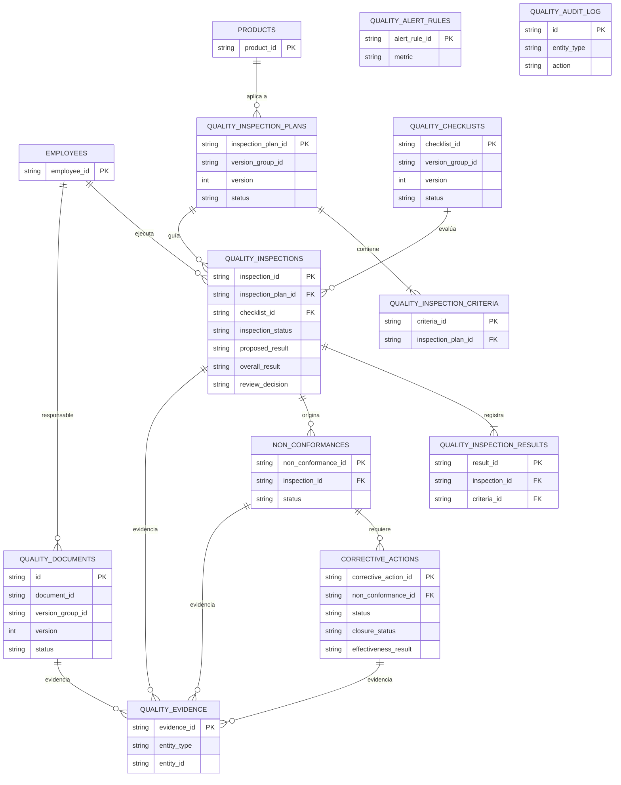

# Modelo de Datos: Módulo de Control de Calidad

**Módulo:** Control de Calidad
**Proyecto:** ERP Frontend MVP — Modelación de Sistemas (UdeC)
**Actualizado:** 2026-11-24
**Fuente canónica:** [spec.md](spec.md)
**Contratos:** [quality-storage.md](contracts/quality-storage.md), [inspection-engine.md](contracts/inspection-engine.md), [quality-workflow.md](contracts/quality-workflow.md), [quality-permissions.md](contracts/quality-permissions.md)

## 1. Propósito y alcance

Este documento define las estructuras para gestionar planes y criterios de inspección, listas de verificación, documentos de calidad, inspecciones, resultados, no conformidades, acciones CAPA, evidencia, alertas y auditoría.

El módulo se integra con productos, empleados, recepciones, órdenes de producción y despachos. Esas entidades son dependencias externas y no se crean desde Control de Calidad. El "lote" se representa mediante el documento origen (`reference_module` + `reference_id`); no existe una entidad de lote separada.

El MVP usa `localStorage`, identificadores `string` y marcas de tiempo ISO. El diseño relacional se conserva como modelo lógico; cualquier implementación con claves `INT` requiere una capa de mapeo explícita.

La capa visual de US15 es derivada: menú, dashboard, bandejas, cuarentena, búsquedas y estados visuales se calculan a partir de las entidades existentes. No crea entidades nuevas ni claves de almacenamiento adicionales.

## 2. Principios del modelo

- **Fuente canónica.** La terminología, los contratos de revisión y los KPIs provienen de `spec.md`; la matriz de permisos de `contracts/quality-permissions.md`.
- **Estado, decisión y resultado separados.** `inspection_status` es `draft|pending_review|completed`; `review_decision` es `approved|approved_conditional|rejected`; `overall_result` es `passed|conditional|failed`. `conditional` nunca es un estado de inspección.
- **Resultado propuesto y final separados.** `proposed_result` lo calcula el motor; `overall_result` se deriva de la revisión. Ninguno se captura manualmente en `draft`.
- **Flujo normal y excepción.** El flujo normal es `draft → pending_review → completed`. El caso heredado `completed` con `proposed_result = conditional` y `review_decision = null` va en bandeja, conserva su estado y sale al registrar cualquier decisión.
- **Aprobado es inmutable.** Planes, listas y documentos aprobados no se editan en la misma versión; se duplican.
- **Historial conservado.** Las versiones anteriores y las entradas de auditoría permanecen aunque el registro se elimine.
- **NC con trigger único.** La no conformidad automática solo se genera por `review_decision = rejected` en revisión válida y sin NC previa. Overrides, cambios manuales y la guarda de críticos no generan NC.
- **CAPA con cierres separados.** `status` es ejecución y `closure_status` es cierre. `completed` no significa cierre aprobado.
- **Auditoría sin duplicados.** El envío registra `status_change`; la decisión final, una sola entrada `approve`/`reject` sobre `overall_result`; el override posterior, una sola `status_change` sobre `overall_result`.
- **Migración idempotente.** Los datos legados se normalizan antes de renderizar bandejas, sin pérdida ni duplicación.

## 3. Diagrama entidad-relación

Las relaciones de lote son polimórficas: `reference_module` identifica el módulo (`goods_receipt`, `production_order`, `shipment`) y `reference_id` el registro origen. La aplicación valida ambos valores. No hay entidades para lote, bandeja, cuarentena, dashboard ni capa visual.

## 4. Diccionario de datos

### 4.1 `quality_inspection_plans`

| Campo | Tipo | Clave | Restricción | Descripción |
|---|---|---|---|---|
| `id` | STRING | PK | Único | Identificador interno del registro. |
| `inspection_plan_id` | STRING | UK | Único por versión | Identificador del plan usado por inspecciones. |
| `version_group_id` | STRING | - | Not Null | Identificador de la familia de versiones. |
| `version` | INT | - | ≥ 1; default 1 | Número de versión. |
| `version_of` | STRING | FK | Opcional | `id` de la versión anterior. |
| `product_id` | STRING | FK | `products.product_id` | Producto al que aplica. |
| `plan_name` | VARCHAR | - | Not Null | Nombre descriptivo. |
| `applicable_stage` | VARCHAR | - | `incoming`, `in_process`, `final` | Etapa de aplicación. |
| `status` | VARCHAR | - | `draft`, `pending_approval`, `approved`, `rejected` | Estado del plan; la decisión se conserva aquí, no en `review_decision`. |
| `submitted_by` | STRING | - | Opcional | Empleado o rol que envía a aprobación. |
| `submitted_at` | TIMESTAMP | - | Opcional | Fecha de envío. |
| `reviewed_by` | STRING | - | Opcional | Empleado o rol que decide. |
| `reviewed_at` | TIMESTAMP | - | Opcional | Fecha de la decisión. |
| `review_justification` | TEXT | - | Obligatorio al rechazar | Motivo de la decisión. |
| `is_locked` | BOOLEAN | - | Default `false` | `true` si tiene inspecciones históricas. |
| `created_by` | STRING | - | Opcional | Empleado o rol creador. |
| `createdAt` / `updatedAt` | TIMESTAMP | - | ISO 8601 | Marcas de tiempo. |

**Reglas:** solo `approved` se ofrece para inspecciones; un plan rechazado vuelve a `draft` al editarse; un plan aprobado con inspecciones históricas se duplica como nueva versión.

### 4.2 `quality_inspection_criteria`

| Campo | Tipo | Clave | Restricción | Descripción |
|---|---|---|---|---|
| `id` | STRING | PK | Único | Identificador interno. |
| `criteria_id` | STRING | UK | Único | Identificador del criterio. |
| `inspection_plan_id` | STRING | FK | Plan existente | Plan al que pertenece. |
| `criteria_name` | VARCHAR | - | Not Null | Variable o parámetro. |
| `expected_value` | DECIMAL | - | Not Null; numérico | Valor o límite estándar. |
| `tolerance` | DECIMAL | - | ≥ 0 | Margen para `range`. |
| `unit` | VARCHAR | - | Not Null | Unidad de medida. |
| `comparison_type` | VARCHAR | - | `range`, `min`, `max`, `boolean` | Regla de comparación. |
| `is_critical` | BOOLEAN | - | Not Null | Si falla, el resultado no puede ser `passed`. |
| `is_locked` | BOOLEAN | - | Default `false` | `true` si tiene resultados históricos. |

### 4.3 `quality_checklists`

| Campo | Tipo | Clave | Restricción | Descripción |
|---|---|---|---|---|
| `id` | STRING | PK | Único | Identificador interno. |
| `checklist_id` | STRING | UK | Único por versión | Identificador usado por inspecciones. |
| `version_group_id` | STRING | - | Not Null | Familia de versiones. |
| `version` | INT | - | ≥ 1; default 1 | Número de versión. |
| `version_of` | STRING | FK | Opcional | Versión anterior. |
| `name` | VARCHAR | - | Not Null | Nombre de la lista. |
| `category` | VARCHAR | - | Not Null | Categoría. |
| `description` | TEXT | - | Opcional | Descripción. |
| `status` | VARCHAR | - | `draft`, `pending_approval`, `approved`, `rejected`; legado `archived` | Estado; `archived` queda fuera del flujo. |
| `submitted_by` / `submitted_at` | STRING / TIMESTAMP | - | Opcional | Envío a aprobación. |
| `reviewed_by` / `reviewed_at` | STRING / TIMESTAMP | - | Opcional | Decisión. |
| `review_justification` | TEXT | - | Obligatorio al rechazar | Motivo. |
| `criteria` | ARRAY | - | ≥ 1 para enviar | Criterios de la lista. |
| `evaluations` | ARRAY | - | Default `[]` | Evaluaciones legadas o históricas. |
| `is_locked` | BOOLEAN | - | Default `false` | `true` con evaluaciones/inspecciones históricas. |
| `created_by` | STRING | - | Opcional | Creador. |
| `createdAt` / `updatedAt` | TIMESTAMP | - | ISO 8601 | Marcas de tiempo. |

**Reglas:** solo `approved` se ofrece para inspecciones; `archived` es legado no seleccionable; una lista aprobada con historial se duplica.

### 4.4 `quality_documents`

| Campo | Tipo | Clave | Restricción | Descripción |
|---|---|---|---|---|
| `id` | STRING | PK | Único | Identificador interno de la versión. |
| `document_id` | VARCHAR | UK lógica | Código `DOC-###`, compartido entre versiones | Código del documento. |
| `version_group_id` | STRING | - | Not Null | Familia de versiones. |
| `version` | INT | - | ≥ 1 | Versión del documento. |
| `version_of` | STRING | FK | Opcional | `id` de la versión anterior. |
| `name` | VARCHAR | - | Not Null | Nombre. |
| `category` | VARCHAR | - | `manual`, `procedure`, `regulation`, `certificate`, `specification`, `other` | Tipo/categoría. |
| `description` | TEXT | - | Opcional | Descripción. |
| `responsible_employee_id` | STRING | FK | `employees.employee_id` | Responsable. |
| `file_name` | VARCHAR | - | Not Null | Nombre del archivo principal. |
| `mime_type` | VARCHAR | - | Según validación documental existente | Tipo del archivo principal. |
| `size_bytes` | INT | - | > 0; ≤ 10 MB | Tamaño del archivo principal. |
| `data_url` | TEXT | - | Not Null | Contenido base64. |
| `status` | VARCHAR | - | `draft`, `pending_review`, `approved`, `rejected`; legado `archived` | Estado; `under_review` se migra a `pending_review`. |
| `submitted_by` / `submitted_at` | STRING / TIMESTAMP | - | Opcional | Envío a revisión. |
| `reviewed_by` / `reviewed_at` | STRING / TIMESTAMP | - | Opcional | Decisión. |
| `review_justification` | TEXT | - | Obligatorio al rechazar | Motivo. |
| `created_by` | STRING | - | Opcional | Creador. |
| `uploaded_at` / `updated_at` | TIMESTAMP | - | ISO 8601 | Marcas de tiempo. |

**Reglas:** el archivo principal usa el límite documental de 10 MB y su validación propia; la evidencia adicional usa PNG/JPG/PDF, 5 MB por archivo y 8 MB acumulados. Un documento aprobado se versiona duplicándolo.

### 4.5 `quality_inspections`

| Campo | Tipo | Clave | Restricción | Descripción |
|---|---|---|---|---|
| `id` | STRING | PK | Único | Identificador interno. |
| `inspection_id` | STRING | UK | Único | Identificador de la inspección. |
| `inspection_plan_id` | STRING | FK | Plan `approved` | Plan aplicado. |
| `checklist_id` | STRING | FK | Lista `approved` | Lista aplicada. |
| `checklist_version` | INT | - | ≥ 1 | Versión de la lista usada. |
| `inspector_id` | STRING | FK | `employees.employee_id` | Inspector ejecutor. |
| `reference_module` | VARCHAR | Polimórfica | `goods_receipt`, `production_order`, `shipment` | Módulo origen. |
| `reference_id` | STRING | Polimórfica | Registro existente | Documento origen/lote. |
| `inspection_date` | DATE | - | Not Null | Fecha de ejecución. |
| `inspection_status` | VARCHAR | - | `draft`, `pending_review`, `completed` | Estado del flujo; nunca `conditional`. |
| `proposed_result` | VARCHAR | - | `passed`, `conditional`, `failed`; Null en `draft` | Dictamen calculado al enviar a revisión. |
| `overall_result` | VARCHAR | - | `passed`, `conditional`, `failed`; Null antes de decisión o en legado sin resultado | Resultado final; `null` se excluye de KPIs. |
| `review_decision` | VARCHAR | - | `approved`, `approved_conditional`, `rejected`; Null antes de revisión | Decisión del Jefe. `approved → passed`, `approved_conditional → conditional`, `rejected → failed`. |
| `review_justification` | TEXT | - | Obligatorio si difiere o es condicional/reprobado | Motivo de la revisión. |
| `reviewed_by` / `reviewed_at` | STRING / TIMESTAMP | - | Obligatorios al decidir | Revisor y fecha. |
| `submitted_by` / `submitted_at` | STRING / TIMESTAMP | - | Opcional | Envío a revisión. |
| `override_justification` | TEXT | - | Obligatorio en cambios posteriores | Motivo de cambio manual. |
| `overridden_by` / `override_at` | STRING / TIMESTAMP | - | Opcional | Autoría y fecha del cambio manual. |
| `legacy_completed` | BOOLEAN | - | Default `false` | `true` en inspecciones migradas `completed` sin `review_decision`; no determina por sí solo la bandeja. |
| `createdAt` / `updatedAt` | TIMESTAMP | - | ISO 8601 | Marcas de tiempo. |

**Reglas:** `pending_review` no cuenta en KPIs ni libera el lote; `rejected` produce `overall_result = failed`; las decisiones `approved` y `approved_conditional` exigen ausencia de críticos fallidos y de mediciones faltantes. Un cambio posterior a `completed` conserva el estado y no genera NC automática.

### 4.6 `quality_inspection_results`

| Campo | Tipo | Clave | Restricción | Descripción |
|---|---|---|---|---|
| `id` | STRING | PK | Único | Identificador interno. |
| `result_id` | STRING | UK | Único | Identificador del resultado. |
| `inspection_id` | STRING | FK | Inspección existente | Inspección asociada. |
| `criteria_id` | STRING | FK | Criterio existente | Criterio evaluado. |
| `measured_value` | DECIMAL | - | Numérico | Medición; nunca vacío, `NaN` ni `Infinity`. |
| `pass_fail` | BOOLEAN | - | Calculado | Cumplimiento; nunca capturado manualmente. |

### 4.7 `non_conformances`

| Campo | Tipo | Clave | Restricción | Descripción |
|---|---|---|---|---|
| `id` | STRING | PK | Único | Identificador interno. |
| `non_conformance_id` | STRING | UK | Único | Identificador de la NC. |
| `inspection_id` | STRING | FK | Opcional en NC manual; obligatoria en NC automática | Inspección de origen. |
| `reference_module` / `reference_id` | VARCHAR / STRING | Polimórfica | Lote del origen | Trazabilidad. |
| `product_id` | STRING | FK | `products.product_id` | Producto afectado. |
| `description` | TEXT | - | No vacío | Descripción; autogenerada y editable en NC automática. |
| `defect_type` | VARCHAR | - | `dimensional`, `functional`, `packaging`, `other` | Tipo de defecto; inicia en `other`. |
| `severity` | VARCHAR | - | `minor`, `major`, `critical` | Severidad; inicia en `major`. |
| `status` | VARCHAR | - | `open`, `under_review`, `closed` | Resolución. |
| `responsible_employee_id` | STRING | FK | Empleado existente | Responsable. |
| `created_by` | STRING | - | Opcional | Creador. |
| `createdAt` / `updatedAt` | TIMESTAMP | - | ISO 8601 | Marcas de tiempo. |

### 4.8 `corrective_actions`

| Campo | Tipo | Clave | Restricción | Descripción |
|---|---|---|---|---|
| `id` | STRING | PK | Único | Identificador interno. |
| `corrective_action_id` | STRING | UK | Único | Identificador CAPA. |
| `non_conformance_id` | STRING | FK | NC existente | NC de origen. |
| `responsible_employee_id` | STRING | FK | Empleado existente | Responsable. |
| `action_description` | TEXT | - | No vacío | Medida. |
| `root_cause` | TEXT | - | No vacío | Causa raíz. |
| `action_category` | VARCHAR | - | `corrective`, `preventive` | Categoría. |
| `action_type` | VARCHAR | - | `resampling`, `rework`, `other` | Tipo. |
| `start_date` | DATE | - | YYYY-MM-DD | Inicio. |
| `due_date` | DATE | - | YYYY-MM-DD | Vencimiento. |
| `expected_result` | TEXT | - | Opcional | Resultado esperado. |
| `observations` | TEXT | - | Opcional | Observaciones. |
| `progress` | INT | - | 0–100 | Avance. |
| `status` | VARCHAR | - | `pending`, `in_progress`, `completed` | Estado de ejecución; `completed` indica ejecución reportada. |
| `completed_at` | TIMESTAMP | - | Opcional | Fin de ejecución. |
| `closure_status` | VARCHAR | - | Null, `pending`, `approved`, `rejected` | Estado de cierre, independiente de `status`. |
| `closure_requested_at` | TIMESTAMP | - | Opcional | Solicitud de cierre. |
| `closure_reviewed_by` / `closure_reviewed_at` | STRING / TIMESTAMP | - | Opcional | Revisor y fecha de la decisión de cierre. |
| `closure_justification` | TEXT | - | Obligatorio al rechazar | Motivo del rechazo de cierre. |
| `effectiveness_result` | VARCHAR | - | Null, `effective`, `not_effective` | Revisión de eficacia; obligatoria antes de aprobar cierre. |
| `effectiveness_observations` | TEXT | - | Obligatorio con resultado | Sustento de eficacia. |
| `effectiveness_reviewed_by` / `effectiveness_reviewed_at` | STRING / TIMESTAMP | - | Opcional | Revisor y fecha de eficacia. |
| `createdAt` / `updatedAt` | TIMESTAMP | - | ISO 8601 | Marcas de tiempo. |

**Reglas:** solo el Jefe aprueba o rechaza el cierre; el rechazo fija `closure_status = rejected` y `status = in_progress`; la eficacia se registra en una revisión separada; una CAPA con cierre aprobado no se considera vencida; una NC puede cerrarse sin CAPA aprobada.

### 4.9 `quality_evidence`

| Campo | Tipo | Clave | Restricción | Descripción |
|---|---|---|---|---|
| `id` | STRING | PK | Único | Identificador interno. |
| `evidence_id` | STRING | UK | Único | Identificador de evidencia. |
| `entity_type` | VARCHAR | Polimórfica | `inspection`, `non_conformance`, `corrective_action`, `document` | Entidad vinculada. |
| `entity_id` | STRING | Polimórfica | Registro existente | ID de la entidad. |
| `file_name` | VARCHAR | - | Not Null | Nombre original. |
| `mime_type` | VARCHAR | - | `image/png`, `image/jpeg`, `application/pdf` | Tipo permitido. |
| `size_bytes` | INT | - | > 0; ≤ 5 MB | Tamaño por archivo. |
| `data_url` | TEXT | - | Not Null | Contenido base64. |
| `uploaded_by` | STRING | - | Not Null | Autor: empleado o rol como metadato. |
| `uploaded_at` | TIMESTAMP | - | Not Null | Fecha. |

**Restricción acumulada:** toda la colección no supera 8 MB; una carga que exceda el límite o la cuota de `localStorage` se rechaza conservando la evidencia previa. El archivo principal de un documento no usa esta cuota de evidencia y conserva su límite de 10 MB.

### 4.10 `quality_alert_rules`

| Campo | Tipo | Clave | Restricción | Descripción |
|---|---|---|---|---|
| `id` | STRING | PK | Único | Identificador interno. |
| `alert_rule_id` | STRING | UK | Único | Identificador de la regla. |
| `metric` | VARCHAR | - | `approval_rate`, `open_non_conformances`, `overdue_capa`, `capa_effectiveness`, `pending_inspections` | Indicador. |
| `operator` | VARCHAR | - | `lt`, `lte`, `gt`, `gte`, `eq` | Operador. |
| `threshold` | DECIMAL | - | Rango según métrica | Umbral. |
| `severity` | VARCHAR | - | `info`, `warning`, `critical` | Severidad. |
| `is_active` | BOOLEAN | - | Default `true` | Activa. |

**Rangos:** tasas 0–100; conteos ≥ 0. No se permite más de una regla activa por `metric` + `operator`. Las alertas son informativas, no bloquean ni generan NC.

### 4.11 `quality_audit_log`

| Campo | Tipo | Clave | Restricción | Descripción |
|---|---|---|---|---|
| `id` | STRING | PK | Único | Identificador. |
| `entity_type` | VARCHAR | - | `inspection_plan`, `checklist`, `document`, `inspection`, `non_conformance`, `corrective_action` | Entidad auditada. |
| `entity_id` | STRING | - | Not Null | ID conservado tras eliminación. |
| `reference_module` | VARCHAR | - | Null si no aplica | Módulo del lote; permite filtrar tras borrar el registro. |
| `reference_id` | STRING | - | Null si no aplica | Documento origen. |
| `action` | VARCHAR | - | `create`, `update`, `review`, `approve`, `reject`, `status_change`, `delete` | Acción. |
| `changed_field` | VARCHAR | - | Not Null | Campo o estado modificado. |
| `before_value` | JSON | - | `null` en `create` | Valor anterior. |
| `after_value` | JSON | - | `null` en `delete` | Valor nuevo; en decisiones incluye decisión, resultado, revisor y fecha. |
| `actor` | STRING | - | Not Null | Empleado seleccionado; solo si no existe, rol activo como metadato. |
| `timestamp` | TIMESTAMP | - | ISO 8601 | Fecha. |
| `justification` | TEXT | - | Opcional u obligatoria según decisión | Motivo. |

**Conservación:** las entradas permanecen tras eliminaciones permitidas y cascadas. Una decisión final de inspección emite una sola entrada `approve`/`reject` sobre `overall_result`; no se duplica como `update` ni como `status_change` por pasar a `completed`. Un permiso denegado no genera entrada.

## 5. Máquinas de estado

### 5.1 Planes y listas

`draft → pending_approval → approved | rejected`

- `rejected → draft` al editar, conservando la justificación.
- `approved` no se edita en la misma versión; se duplica.
- `pending_approval` exige al menos un criterio y campos obligatorios.
- La aprobación registra revisor y fecha; el rechazo exige justificación.
- Las decisiones usan `status`, no `review_decision`.

### 5.2 Documentos

`draft → pending_review → approved | rejected`

- `under_review` es legado equivalente a `pending_review`; `archived` queda fuera del flujo.
- `rejected → draft` al editar; `approved` se versiona duplicándolo.
- La aprobación exige archivo/metadatos previsualizables.
- El rechazo exige justificación.

### 5.3 Inspecciones

Flujo normal: `draft → pending_review → completed`.

- `draft`: mediciones editables; `proposed_result = null`; sin `overall_result` ni `review_decision`.
- `pending_review`: bloqueada para el Inspector; no cuenta en KPIs; no libera el lote; ya tiene `proposed_result`.
- `completed`: dictamen final derivado de `review_decision`; la decisión se registra antes o en la misma operación que fija el estado.
- Mapeo: `approved → passed`, `approved_conditional → conditional`, `rejected → failed`.
- `approved` y `approved_conditional` exigen ausencia de críticos fallidos y de mediciones faltantes.
- Caso heredado/excepción: `completed` con `proposed_result = conditional` y `review_decision = null` permanece en la bandeja, conserva `inspection_status = completed` y sale al registrar cualquier decisión. Nunca retrocede a `pending_review`.
- Un registro `completed` con `review_decision = null` y resultado distinto de `conditional` es final: no va a bandeja y cuenta por su `overall_result` conservado.
- `overall_result = null` se excluye de KPIs; no se le asigna un resultado inventado.
- `conditional` es resultado, nunca estado de inspección.

### 5.4 CAPA

Ejecución: `pending → in_progress → completed`.

Cierre: `pending → approved | rejected`.

- Al marcar `status = completed` se registra `completed_at` y se deja `closure_status = pending`.
- Solo el Jefe aprueba o rechaza el cierre.
- La aprobación exige `effectiveness_result` y observaciones registradas previamente.
- El rechazo fija `closure_status = rejected` y `status = in_progress`, con justificación.
- `completed` no implica cierre aprobado; una NC puede cerrarse sin CAPA aprobada.
- La cuarentena se deriva de NC en `open` o `under_review`.

## 6. Versionado

- `version_group_id` identifica la familia; `version` es consecutivo; `version_of` apunta a la versión anterior.
- La primera versión usa `version = 1`, `version_group_id = id`, `version_of = null`.
- Una nueva versión nace en `draft`, reutiliza el código de negocio cuando exista (`document_id`) y conserva la versión aprobada anterior.
- Editar un borrador no incrementa `version`.
- Editar un aprobado está bloqueado; la UI ofrece "Crear nueva versión".
- Las inspecciones conservan `inspection_plan_id` y `checklist_id` de la versión exacta usada.

## 7. Migración de datos legados

La migración se ejecuta antes de renderizar cualquier bandeja o vista dependiente de estados migrados; es idempotente, no elimina registros y reporta solo cambios efectivos.

| Entidad | Regla |
|---|---|
| Planes sin `status` | `approved`; `version = 1`; `version_group_id = id`. |
| Listas `active` | `approved`. |
| Listas `draft` | `draft`. |
| Listas `archived` | Se conserva `archived` como legado no seleccionable. |
| Documentos `active` | `approved`. |
| Documentos `under_review` | `pending_review`. |
| Documentos `archived` | Se conserva `archived` como legado no seleccionable. |
| Documentos sin `version_group_id` | `version_group_id = id`; `version_of = null`. |
| Inspecciones `completed` con `review_decision = null` | `legacy_completed = true`; conservar `overall_result`. Si `proposed_result = conditional` —o falta y `overall_result = conditional`, caso en que se completa— permanece en bandeja sin cambiar `inspection_status`. Si el resultado es distinto de `conditional`, es final, sin bandeja y cuenta por `overall_result`. Si `overall_result = null`, se excluye de KPIs y no se inventa un resultado. |
| Inspecciones `completed` con `review_decision` | No se marcan como pendientes; no van a bandeja; cuentan por `overall_result`. |
| Inspecciones sin `proposed_result` | Se completa con `overall_result` solo si existe; en caso contrario queda `null`. |
| CAPA `completed` sin `closure_status` | `closure_status = pending`; `closure_requested_at = completed_at || updatedAt`. |
| CAPA sin `effectiveness_result` | `null`; no se aprueba cierre sin revisión de eficacia. |
| Evidencia | Se conserva; se valida `entity_type` ampliado. |
| Auditoría | Se conserva; se normalizan entidades/acciones desconocidas sin borrar entradas. |

La marca `legacy_completed` identifica origen migrado, pero la bandeja se determina por `proposed_result = conditional` y `review_decision = null`, no por la marca aislada.

## 8. Reglas de integridad

- **Planes/listas/documentos:** solo versiones `approved` se seleccionan; un plan sin criterios no inicia inspección.
- **Evaluación:** `range` inclusivo, `min`, `max`, `boolean`; `pass_fail` calculado, nunca capturado.
- **Resultado propuesto:** `failed` si falla un criterio crítico; `conditional` si solo fallan no críticos; `passed` si todo cumple; `overall_result` sigue `null`.
- **Revisión:** `approved` y `approved_conditional` no se permiten con críticos fallidos o mediciones faltantes.
- **NC automática:** solo cuando `review_decision = rejected` (`overall_result = failed`) desde `pending_review` o desde el caso heredado condicional sin decisión, y no existe NC previa.
- **Sin NC automática:** overrides, cambios manuales posteriores, creación manual y la guarda de críticos fallidos o sin medición.
- **CAPA:** no se aprueba cierre sin eficacia; el rechazo de cierre fija `closure_status = rejected` y `status = in_progress`.
- **Cuarentena:** lote con NC `open`/`under_review`; "Cuarentena - En tratamiento" si la NC tiene al menos una CAPA; sale cuando esas NC pasan a `closed`.
- **Lotes pendientes:** documentos origen sin inspección `completed`; `draft` y `pending_review` no liberan; el legado condicional sin decisión tampoco libera por estar en bandeja.
- **Vencimiento CAPA:** `due_date < hoy` y `closure_status != approved`.
- **Eliminación:** plan sin inspecciones elimina criterios; inspección con NC no se elimina; NC elimina CAPA y evidencia; CAPA/documento eliminan su evidencia; aprobados con historial no se eliminan.
- **Evidencia:** PNG/JPG/PDF; 5 MB por archivo; 8 MB acumulados o cuota; vínculo válido; documento principal hasta 10 MB.
- **Alertas:** informativas; no bloquean ni generan NC.
- **Exportación:** vista derivada; no se persiste.

## 9. Mapa de auditoría

| Operación | `action` | `changed_field` | `before_value` | `after_value` |
|---|---|---|---|---|
| Alta | `create` | Estado inicial correspondiente | `null` | Estado inicial, por ejemplo `{ status: 'draft' }` o `{ inspection_status: 'draft' }`. |
| Edición de borrador | `update` | Campo modificado | Valor anterior | Valor nuevo. |
| Envío a revisión/aprobación | `status_change` | `status` o `inspection_status` | Estado anterior | Estado nuevo. |
| Nota de revisión sin decisión | `review` | `review_justification` | Anterior | Nueva. |
| Decisión final de inspección | `approve` o `reject` | `overall_result` | Resultado anterior | `{ overall_result, review_decision, reviewed_by, reviewed_at }` más justificación cuando corresponda. |
| Decisión de plan, lista o documento | `approve` o `reject` | `status` | Estado anterior | `{ status, reviewed_by, reviewed_at, review_justification }`. |
| Decisión de cierre CAPA | `approve` o `reject` | `closure_status` | Cierre anterior | `{ closure_status, status, closure_reviewed_by, closure_reviewed_at, closure_justification, effectiveness_result }`. |
| Revisión de eficacia CAPA | `review` | `effectiveness_result` | Anterior | `{ effectiveness_result, effectiveness_observations, effectiveness_reviewed_by, effectiveness_reviewed_at }`. |
| Override de inspección | `status_change` | `overall_result` | Resultado anterior | `{ overall_result, overridden_by, override_at, override_justification }`. |
| Cambio operativo | `status_change` | Campo de estado | Anterior | Nuevo. |
| Eliminación permitida | `delete` | Estado o campo aplicable | Último valor | `null`. |

**Reglas de no duplicación:** la decisión final de inspección emite una sola entrada `approve`/`reject`; el cambio de `inspection_status` a `completed` no se audita por separado. El override emite una sola `status_change` sobre `overall_result`. La revisión de eficacia CAPA es una entrada `review` distinta de la decisión de cierre. El rechazo de cierre no genera una segunda `status_change` por volver a `in_progress`; ambos valores viajan en la misma entrada `reject`. Una acción denegada por permisos no registra auditoría.

## 10. Métricas y vistas derivadas

- `approvalRate(inspections, stage?)`: `count(inspection_status = completed AND overall_result = passed) / count(inspection_status = completed AND overall_result IN (passed, conditional, failed))`, con 0 si el denominador es 0. `conditional` cuenta en el denominador y no en el numerador. `draft`, `pending_review` y `overall_result = null` no participan.
- `pendingInspections(inspections)`: cantidad de registros con `inspection_status = draft` o `pending_review`. Excluye el legado `completed` condicional sin decisión; ese caso solo aparece en la bandeja.
- `reviewQueue(inspections)`: `pending_review` más `completed` con `proposed_result = conditional` y `review_decision = null`. Sale cualquier registro en cuanto existe `review_decision`.
- `derivedDashboard(...)`: calcula indicadores, conteos, gráficos, actividad reciente y accesos rápidos desde colecciones existentes; no almacena cifras ni crea entidades.
- `quarantine(...)`: lotes con NC `open`/`under_review`; no se persiste como entidad.
- `capaEffectiveness(actions)`: cierres aprobados con `effectiveness_result = effective` sobre cierres aprobados; 0 si no hay cierres aprobados.

## 11. Capa visual derivada

US15 no introduce entidades. Las 15 pantallas —dashboard, lotes pendientes, planes y criterios, listas de verificación, documentos, ejecución de inspección, revisión de inspecciones, aprobaciones pendientes, no conformidades, CAPA, cuarentena, historial, bitácora, exportación y alertas— se renderizan desde los datos anteriores.

El menú de cinco categorías y 12 entradas con IDs exactos, la matriz del dashboard, los tokens visuales, las columnas clave, la búsqueda sobre el conjunto ya filtrado, los estados vacíos, la carga, el foco y el contraste AA son requisitos de presentación y verificación. No requieren campos nuevos; las etiquetas "Borrador", "Pendiente", "Aprobado", "Rechazado", "Vencido" y las etiquetas secundarias de resultado "Aprobado", "Condicional", "Reprobado" se derivan de estado/resultado. En particular, `approved_conditional` muestra el estado "Aprobado" y el resultado "Condicional".
